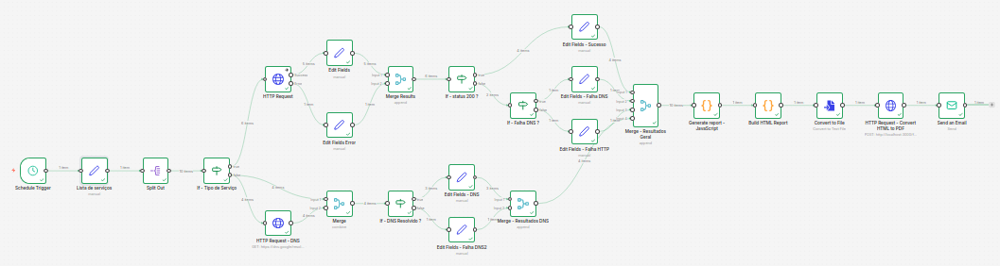
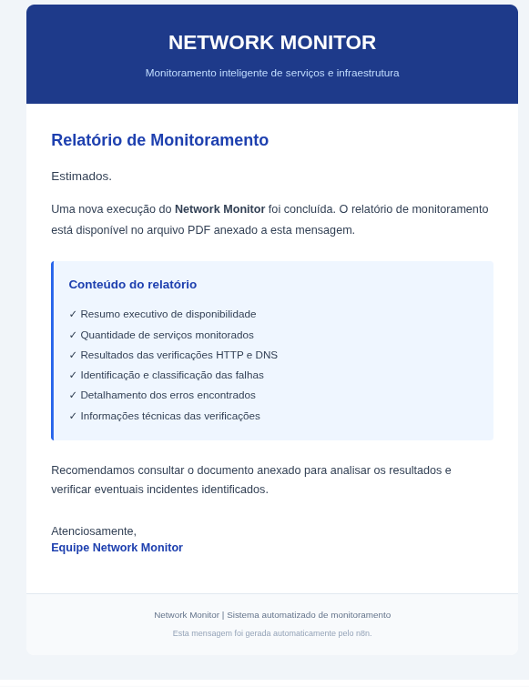
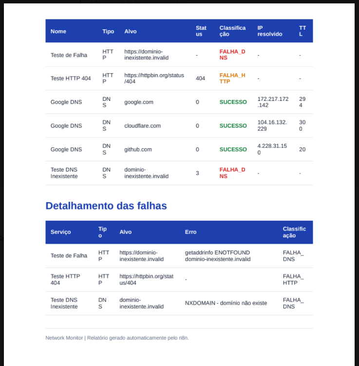

# Network Monitor -- Automated HTTP & DNS Monitoring with n8n

Automação de monitoramento de serviços e infraestrutura utilizando
**n8n**, com verificações HTTP e DNS, identificação de falhas,
classificação de resultados e geração automatizada de relatórios em PDF
enviados por e-mail.

## Sobre o projeto

O **Network Monitor** é um workflow desenvolvido para apoiar atividades
de suporte de sistemas e infraestrutura de TI.

A solução automatiza verificações de disponibilidade, identifica falhas
de comunicação e resolução DNS, classifica os resultados e consolida as
informações em um relatório PDF enviado automaticamente por e-mail.

O objetivo é reduzir verificações manuais, facilitar a identificação de
indisponibilidades e proporcionar maior visibilidade sobre os serviços
monitorados.

## Funcionalidades

-   Monitoramento de serviços HTTP.
-   Verificação de resolução DNS por DNS over HTTPS.
-   Processamento individual de múltiplos serviços.
-   Identificação de falhas de resolução de domínio.
-   Identificação de respostas HTTP diferentes de 200.
-   Classificação automática dos resultados.
-   Consolidação dos resultados HTTP e DNS.
-   Cálculo de indicadores de disponibilidade.
-   Geração de relatório em HTML.
-   Conversão do relatório HTML para PDF.
-   Envio automático do relatório por e-mail.

## Visão do workflow

O workflow é organizado em etapas para separar a configuração, a
execução das verificações, o tratamento dos resultados e a geração do
relatório.



> Coloque a captura de tela geral do workflow em `docs/workflow.png`. Se
> o arquivo tiver outro nome, ajuste o caminho desta imagem.

## Como funciona

1.  **Lista de serviços:** define os serviços que serão monitorados,
    seus tipos, alvos e métodos.
2.  **Split Out:** separa a lista para que cada serviço seja processado
    individualmente.
3.  **Identificação do tipo:** direciona cada item para o fluxo HTTP ou
    DNS.
4.  **Verificação HTTP:** realiza a requisição e identifica o código de
    resposta ou o erro ocorrido.
5.  **Verificação DNS:** consulta o domínio e verifica se a resolução
    foi bem-sucedida.
6.  **Classificação:** atribui uma classificação padronizada ao
    resultado.
7.  **Merge - Resultados Gerais:** reúne os resultados dos diferentes
    caminhos de monitoramento.
8.  **Generate Report:** consolida os indicadores e os detalhes da
    execução.
9.  **Geração do documento:** monta o relatório HTML e o converte para
    PDF.
10. **Envio de e-mail:** encaminha o PDF como anexo ao destinatário
    configurado.

## Classificação dos resultados

  -----------------------------------------------------------------------
  Classificação                       Significado
  ----------------------------------- -----------------------------------
  `SUCESSO`                           Verificação concluída conforme o
                                      esperado.

  `FALHA_DNS`                         O domínio não foi resolvido ou
                                      ocorreu uma falha de DNS.

  `FALHA_HTTP`                        A requisição HTTP retornou um
                                      status diferente do esperado.
  -----------------------------------------------------------------------

## Relatório e notificação por e-mail

O relatório reúne os indicadores gerais e o detalhamento dos serviços
monitorados. O fluxo também envia uma mensagem por e-mail com o
documento PDF anexado.

### Mensagem de e-mail



### Relatório de monitoramento



O relatório contempla:

-   Data e horário da execução.
-   Total de serviços monitorados.
-   Quantidade de verificações HTTP e DNS.
-   Número de sucessos.
-   Quantidade de falhas DNS e HTTP.
-   Percentual de disponibilidade.
-   Detalhamento dos serviços e respectivos resultados.
-   Informações de erro identificadas durante as verificações.

## Tecnologias utilizadas

  -----------------------------------------------------------------------
  Tecnologia                          Utilização
  ----------------------------------- -----------------------------------
  **n8n**                             Orquestração e execução do
                                      workflow.

  **JavaScript**                      Tratamento, classificação e
                                      consolidação dos dados nos nodes
                                      Code.

  **HTTP Request**                    Verificações HTTP e consultas DNS
                                      over HTTPS.

  **HTML / CSS**                      Estrutura e apresentação do
                                      relatório.

  **Gotenberg**                       Conversão do HTML para PDF.

  **Docker**                          Execução do serviço Gotenberg.

  **SMTP / Gmail**                    Envio automatizado de e-mails.

  **Linux**                           Ambiente de execução utilizado no
                                      desenvolvimento.
  -----------------------------------------------------------------------

## Requisitos

-   Instância do n8n instalada e configurada.
-   Docker instalado e em execução.
-   Gotenberg disponível para conversão de HTML em PDF.
-   Credenciais de e-mail configuradas no n8n.
-   Acesso à internet para consultar os serviços monitorados.
-   Node.js habilitado para execução dos nodes Code em JavaScript.

## Configuração e execução

1.  Importe o workflow JSON para sua instância do n8n.
2.  Configure as credenciais utilizadas pelo node de envio de e-mail.
3.  Verifique o endereço do serviço Gotenberg configurado no node de
    conversão.
4.  Edite o node **Lista de serviços** para informar os endpoints e
    domínios que deseja monitorar.
5.  Configure o destinatário do relatório no node **Send Email**.
6.  Execute o workflow e confira os resultados e o PDF recebido.

### Exemplo de configuração da lista de serviços

A lista utiliza objetos com os campos `nome`, `tipo`, `alvo` e `metodo`.

``` json
[
  {
    "nome": "HTTPBin",
    "tipo": "HTTP",
    "alvo": "https://httpbin.org/get",
    "metodo": "GET"
  },
  {
    "nome": "Google DNS",
    "tipo": "DNS",
    "alvo": "google.com",
    "metodo": "A"
  }
]
```

Adapte os valores conforme os serviços do ambiente que será monitorado.

## Estrutura sugerida do repositório

``` text
network-monitor/
├── README.md
├── workflow/
│   └── network-monitor.json
└── docs/
    ├── layoutEmail.png
    ├── relatorio1to2.png
    └── workflow.png
```

A estrutura acima é uma sugestão para organizar os arquivos do
repositório. Inclua o JSON exportado do workflow e as imagens
correspondentes antes de publicar.

## Possíveis evoluções

-   Agendamento periódico das verificações.
-   Histórico de disponibilidade em banco de dados.
-   Alertas específicos para serviços críticos.
-   Integração com ferramentas de comunicação e gestão de incidentes.
-   Monitoramento de latência e tempo de resposta.
-   Painel de acompanhamento dos indicadores.

## Segurança

Antes de publicar o workflow, revise o arquivo exportado do n8n e remova
credenciais, tokens, endereços privados e quaisquer dados sensíveis.
Utilize o gerenciamento de credenciais do n8n em vez de inserir segredos
diretamente nos nodes.

## Objetivo do projeto

Demonstrar a aplicação prática da automação no suporte de sistemas e
infraestrutura de TI, reduzindo atividades repetitivas e facilitando a
identificação e a comunicação de falhas.

------------------------------------------------------------------------

**Network Monitor** --- automação e visibilidade para operações de TI.
